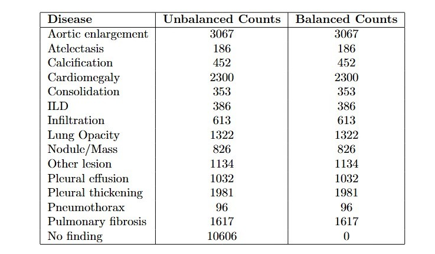
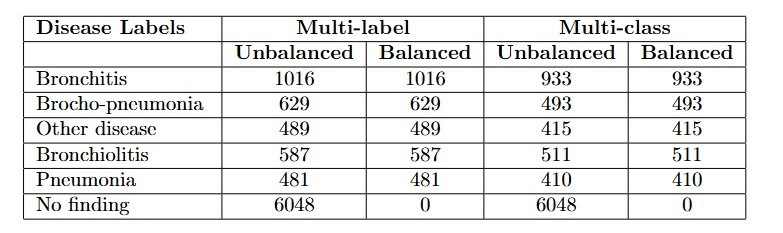
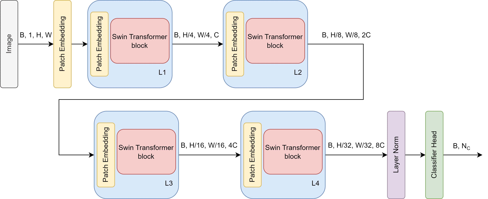
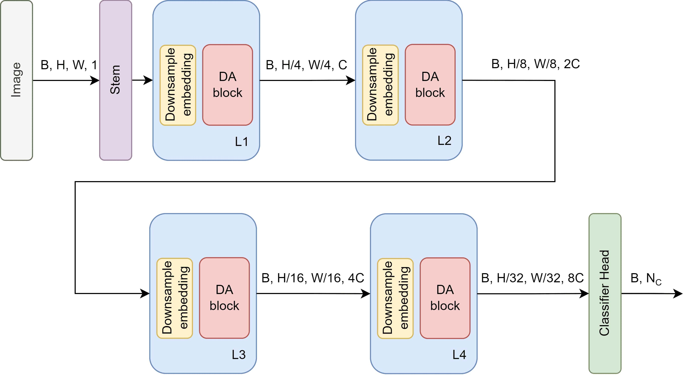
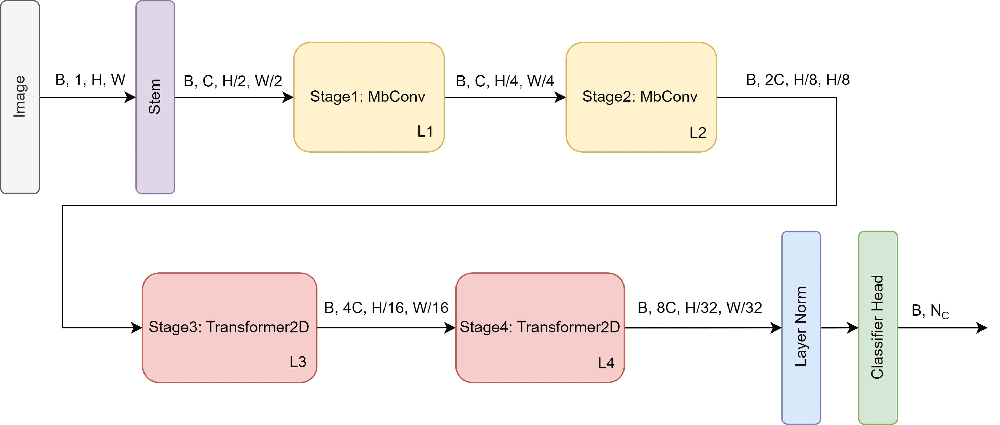
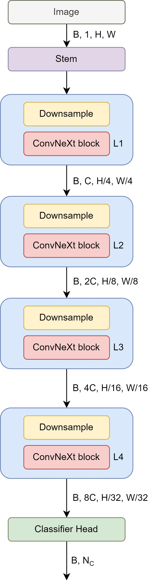
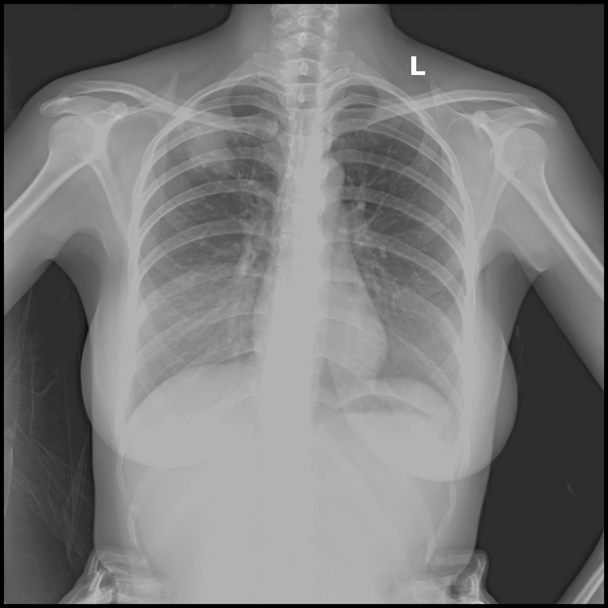

# Comparative Analysis of CNNs vs. Vision Transformers on Chest X-Rays

## 📄 Abstract
This project benchmarks **13 ImageNet-pretrained models**: CNNs (e.g. **ResNet, EfficientNet, ConvNeXt**), Vision Transformers (e.g. **Swin Transformer, PVT, DaViT**) and hybrids (**CoAtNet**), for thoracic disease classification on two chest X-ray datasets:

* **VinDr-CXR** (adults): multi-label classification of 14 findings + *No finding*.
* **VinDr-PCXR** (children): multi-label and multi-class classification of 5 diseases + *No finding*.

All models share the same preprocessing, input size (224 × 224) and two-stage fine-tuning recipe, so differences in results come from the architecture and its pretraining.

On adult X-rays the strongest models are closely matched, with macro AUC ≈ 0.93 for Swin Transformer, CoAtNet and ConvNeXt (PVT is highest at 0.939). Pediatric X-rays are much harder: the best macro AUC is ≈ 0.73 (CoAtNet), and multi-class accuracy stays close to the majority-class baseline.

📘 Full details are in the [thesis (PDF)](docs/Chest%20X-Ray%20Classification%20Thesis.pdf).

---

## 🚀 Key Results

Representative models from each family are shown below (one Transformer, one hybrid, one CNN). Results for all 13 models are in [`assets/tables/Performance_Metrics.csv`](assets/tables/Performance_Metrics.csv).

### 1. Adult Dataset (VinDr-CXR): Multi-Label, 15 labels
| Model | Type | Accuracy* | Precision | Recall | F1 | AUC |
| :--- | :--- | :---: | :---: | :---: | :---: | :---: |
| Swin Transformer | Transformer | 95.22% | 0.596 | 0.393 | 0.448 | 0.933 |
| CoAtNet | Hybrid (Conv + Attention) | 95.09% | 0.702 | 0.452 | 0.517 | 0.930 |
| ConvNeXt | CNN | 95.43% | 0.700 | 0.427 | 0.482 | 0.927 |

### 2. Pediatric Dataset (VinDr-PCXR): 6 labels
| Model | Multi-label AUC | Multi-label F1 | Multi-class AUC | Multi-class F1 | Multi-class Accuracy |
| :--- | :---: | :---: | :---: | :---: | :---: |
| Swin Transformer | 0.726 | 0.191 | 0.661 | 0.234 | 62.47% |
| CoAtNet | 0.732 | 0.198 | 0.725 | 0.241 | 66.17% |
| ConvNeXt | 0.721 | 0.157 | 0.710 | 0.177 | 67.21% |

Pediatric classification is considerably harder than adult. In the multi-class task, **67.1%** of the test images are *No finding*, so a model that always predicts *No finding* already reaches 67.1% accuracy. AUC and F1 are therefore the more informative metrics here.

**\*Metrics:**
* **Multi-label:** a label is predicted positive when its sigmoid probability is > 0.5. Accuracy, precision, recall and F1 are computed per label and then macro-averaged. Since most labels of most images are negative, this accuracy is high even for weak models.
* **Multi-class:** the predicted class is the one with the highest softmax probability. Accuracy is the fraction of correctly classified images; precision, recall and F1 are macro-averaged over classes.
* **AUC** is the macro-averaged ROC-AUC over labels (one-vs-rest for multi-class). Prefer AUC and F1 when comparing models.

---

## 📂 Repository Structure

```text
CXR-Classification-ViT-vs-CNN/
│
├── assets/
│   ├── figures/
│   │   ├── architectures/   # Block diagrams of Swin, DaViT, CoAtNet, ConvNeXt
│   │   ├── statistics/      # Class distribution charts and tables
│   │   └── preprocessing/   # Preprocessing pipeline visualisation
│   ├── samples/             # Sample X-rays from both datasets
│   └── tables/              # Results of all models (CSV)
│
├── docs/
│   └── Chest X-Ray Classification Thesis.pdf
│
├── notebooks/
│   ├── Vindr_CXR/                                   # Adult, Unbalanced, Multi-label
│   │   ├── CoAtNet_CXR_Unbalanced_Multilabel.ipynb
│   │   └── Swin_CXR_Unbalanced_Multilabel.ipynb
│   ├── Vindr_PCXR/                                  # Pediatric, Unbalanced, Multi-label & Multi-class
│   │   ├── CoAtNet_PCXR_Unbalanced_Multiclass.ipynb
│   │   ├── CoAtNet_PCXR_Unbalanced_Multilabel.ipynb
│   │   ├── Swin_PCXR_Unbalanced_Multiclass.ipynb
│   │   └── Swin_PCXR_Unbalanced_Multilabel.ipynb
│   └── Model_architectures.ipynb                    # Definitions of all 13 models
│
├── requirements.txt
└── readme.md
```

---

## 📊 Dataset Overview
Both datasets are heavily imbalanced, with *No finding* as by far the most frequent label. We therefore ran every experiment on two versions of each dataset:

* **Unbalanced**: the original label distribution, *No finding* included.
* **Balanced**: the same labels with all *No finding* images removed. This only removes the dominant class; the disease classes themselves are not resampled.

For VinDr-PCXR, only diseases with enough samples were kept: *Bronchitis, Broncho-pneumonia, Other disease, Bronchiolitis, Pneumonia* and *No finding*. For the multi-class task, only images with exactly one of these labels were used.

The notebooks in this repository use the **Unbalanced** setting. The tables below show the sample counts for both versions.

| Adult Dataset (VinDr-CXR) | Pediatric Dataset (VinDr-PCXR) |
| :---: | :---: |
|  |  |
| *Class distribution for Multi-label classification* | *Unbalanced vs. Balanced versions* |

---

## 🧠 Model Architectures
We analysed the internal mechanisms of both CNNs and ViTs. Click below to view the architectural details.

<details>
<summary><b>🔍 View Swin Transformer & DaViT (Vision Transformers)</b></summary>

| Swin Transformer (Shifted Windows) | DaViT (Dual-Attention Mechanism) |
| :---: | :---: |
|  |  |

</details>

<details>
<summary><b>🔍 View CoAtNet & ConvNeXt (Hybrid & Modern CNN)</b></summary>

| CoAtNet (Hybrid) | ConvNeXt (Pure CNN) |
| :---: | :---: |
|  |  |

</details>

---

## 🖼️ Data Preprocessing Pipeline
Every X-ray goes through a 3-stage preprocessing pipeline that improves the visibility of features in low-contrast images:

1. **VOI LUT:** applies the DICOM's Value-of-Interest lookup table to map raw detector values to the intended viewing window (inverted *MONOCHROME1* images are also flipped).
2. **Min-max normalisation** to [0, 1].
3. **CLAHE** (Contrast Limited Adaptive Histogram Equalisation, clip limit 2.0, 8 × 8 tiles) to enhance local contrast.

Decoding DICOMs and applying CLAHE at full resolution on every epoch was too slow, so we ran this pipeline **once offline** using the `read_xray()` function defined in the notebooks, and saved the results as 512 × 512 `.npy` files named `<image_id>.npy`. During training, images are resized to 224 × 224, and the only data augmentation is random zoom (0.9–1.1×). Flips and rotations were left out because chest anatomy is not left-right symmetric.

| Step 1: Original | Step 2: VOI LUT | Step 3: Min-Max Norm and CLAHE |
| :---: | :---: | :---: |
|  |  |  |

---

## 🛠️ Usage

To reproduce the experiments:

1.  **Clone the repository:**
    ```bash
    git clone https://github.com/CellerCity/CXR-Classification-ViT-vs-CNN.git
    cd CXR-Classification-ViT-vs-CNN
    ```

2.  **Install dependencies** (Python 3.10):
    ```bash
    pip install -r requirements.txt
    ```

3.  **Download the datasets** (see [Datasets](#-datasets) below):
    * **Adult:** the notebooks read the label file (`train.csv`) and DICOMs in the format of the Kaggle *VinBigData Chest X-ray Abnormalities Detection* competition.
    * **Pediatric:** VinDr-PCXR from PhysioNet (`image_labels_train.csv`, `image_labels_test.csv` and the DICOMs). Access requires a PhysioNet account and signing the data use agreement.

4.  **Preprocess the DICOMs once:** apply `read_xray()` (defined in the notebooks) to every DICOM, resize the result to 512 × 512 and save it as `<image_id>.npy`. The notebooks load these files.

5.  **Update the paths in the notebook.** The notebooks use Kaggle paths. In the data-loading cell, change:
    * the `pd.read_csv(...)` path(s) to your label CSV(s), and
    * the `root_folder=` argument of `add_file_path_column(...)` to your `.npy` folder(s).

6.  **Run the notebook** (e.g. `notebooks/Vindr_CXR/Swin_CXR_Unbalanced_Multilabel.ipynb`). Training first updates only the classifier head with the backbone frozen, then fine-tunes the whole network at a lower learning rate. Test metrics are computed at the end.
    * We trained across several Kaggle sessions, so in some notebooks the `train(...)` calls are commented out and the testing section loads our saved checkpoints from `/kaggle/input/...`. Uncomment the `train(...)` calls and point `history_path` and `model_path` in the testing section to your own outputs (`history.csv`, `best_model_*.pth`).

---

## 📚 Datasets
If you use these datasets, please cite the original authors:

* **VinDr-CXR:** Nguyen, H. Q., Lam, K., Le, L. T., Pham, H. H., Tran, D. Q., *et al.* (2022). *VinDr-CXR: An open dataset of chest X-rays with radiologist's annotations.* **Scientific Data**, 9, 429. https://doi.org/10.1038/s41597-022-01498-w
  * PhysioNet: https://physionet.org/content/vindr-cxr/1.0.0/
  * Kaggle competition (version used in this project): https://www.kaggle.com/competitions/vinbigdata-chest-xray-abnormalities-detection
* **VinDr-PCXR:** Pham, H. H., Tran, T. T., & Nguyen, H. Q. (2022). *VinDr-PCXR: An open, large-scale pediatric chest X-ray dataset for interpretation of common thoracic diseases* (version 1.0.0). **PhysioNet**. https://doi.org/10.13026/k8qc-na36
  * Paper: Pham, H. H., Nguyen, N. H., Tran, T. T., Nguyen, T. N. M., & Nguyen, H. Q. (2023). *PediCXR: An open, large-scale chest radiograph dataset for interpretation of common thoracic diseases in children.* **Scientific Data**, 10. https://doi.org/10.1038/s41597-023-02102-5

---

## 👥 Contributors
* **Aman Nasim**
* Bobbili Sunny Rishy Vardhan
* Kalakonda Prudhvi Raj

*Supervised by Dr. Srilatha Chebrolu, NIT Andhra Pradesh (2024).*